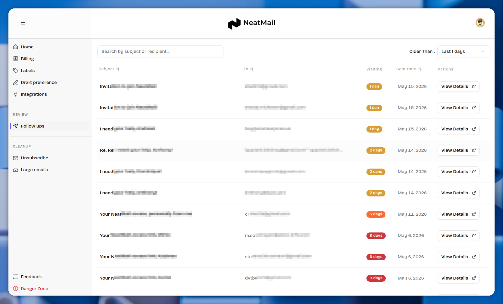
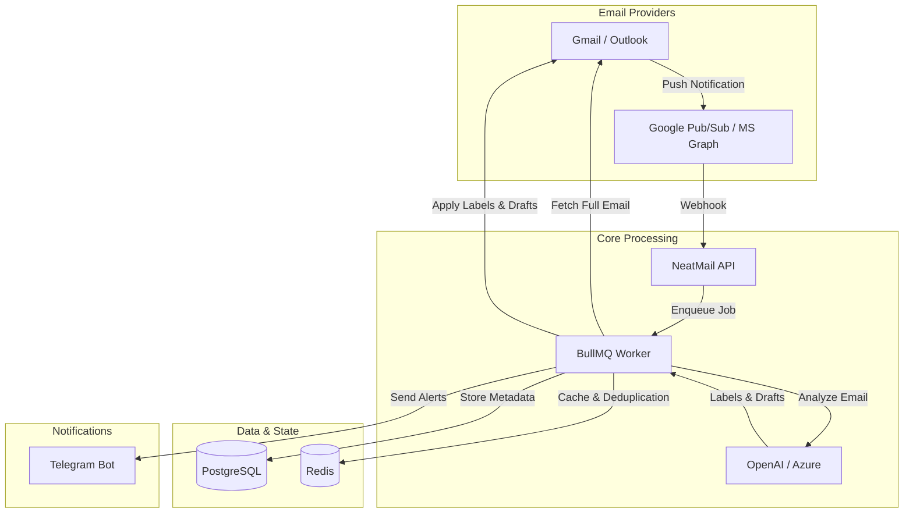

<div align="center">
  <h1>NeatMail</h1>
  <h2><strong>Never drop a promise buried in your inbox</strong></h2>
  <p>NeatMail is an <strong>AI email assistant for Gmail and Outlook</strong> that tracks every promise you make and every promise made to you, files them under one Follow up label, and drafts the follow-up when it's due. It also auto-labels incoming mail and drafts replies in your own voice.</p>

  <p>
    <a href="https://www.neatmail.app">Website</a> •
    <a href="https://www.neatmail.app/pricing">Pricing</a> •
    <a href="#how-neatmail-compares">Compare</a> •
    <a href="https://www.neatmail.app/blog">Blog</a> •
    <a href="https://www.neatmail.app/tools">Free Tools</a> •
    <a href="#features">Features</a> •
    <a href="#getting-started">Self-host</a>
  </p>

  <p>
    
    
    
    
  </p>

  
</div>

---

## Table of Contents

- [What is NeatMail?](#what-is-neatmail)
- [How NeatMail compares](#how-neatmail-compares)
- [Features](#features)
- [Who it's for](#who-its-for)
- [Guides & Resources](#guides--resources)
- [Free Email Tools](#free-email-tools)
- [Getting Started](#getting-started)
  - [Prerequisites](#prerequisites)
  - [Installation](#installation)
- [Architecture](#architecture)
- [Tech Stack](#tech-stack)
- [Configuration](#configuration)
- [Deployment](#deployment)
- [Contributing](#contributing)
- [License](#license)

---

## What is NeatMail?

[NeatMail](https://www.neatmail.app) is an AI email assistant for Gmail and Outlook that tracks promises and drafts the follow-up. It reads every email you send or receive for a commitment with a deadline, such as "I'll send the deck by Friday", whether you made the promise or someone made it to you. Each one goes into a single **Follow up** label with its due date. When your own deadline is close, NeatMail drafts the delivery email. When someone else's promise to you is overdue, it drafts a polite nudge. You review and hit send. It works inside the Gmail or Outlook client you already use, so there is no new app to learn.

| Key facts | |
|---|---|
| What it is | An AI email assistant that tracks promises in both directions and drafts follow-ups |
| Works with | Gmail and Outlook, inside your existing client, connected via OAuth |
| Pricing | Pro $9/month ($7.50/month billed annually), Max $19/month ($15.83/month billed annually). 7-day free trial of Max and a 14-day money-back guarantee on the first payment. [Plans](https://www.neatmail.app/pricing) |
| Self-hosting | Free for personal and commercial use |
| License | Source-available under the [Elastic License 2.0](LICENSE) (ELv2). Reselling a hosted version or building a competing SaaS is not allowed |
| AI models | gpt-5-mini and gpt-5-nano, via Azure OpenAI or OpenAI |
| Your data | OAuth access you can revoke at any time. Email content is not stored, only metadata |
| Security | CASA Tier 2 and ESOF verified |
| Built by | [Lakshay Gupta](https://www.neatmail.app/about), since February 2026. Release notes in the [changelog](https://www.neatmail.app/changelog) |

---

## How NeatMail compares

US list prices for one user on monthly billing, checked October 2026.

| | Starts at | Works in | AI-drafted replies | Self-host | License |
|---|---|---|---|---|---|
| **NeatMail** | $9/month (Pro) | Your Gmail or Outlook | 100 a month on Pro, unlimited on Max ($19) | Yes, free | Source-available (ELv2) |
| [Inbox Zero](https://www.getinboxzero.com) | $20/month (Starter) | Your Gmail or Outlook | Yes | Yes | Open source (AGPL-3.0) |
| [Fyxer](https://www.neatmail.app/comparison/neatmail-vs-fyxer) | $49/seat (Pro) | Your Gmail or Outlook | Pro and Team. The Free plan doesn't draft | No | Proprietary |
| [Superhuman](https://www.neatmail.app/comparison/neatmail-vs-superhuman) | $30/seat (Mail Starter) | Its own email app | On request on Starter, Auto Drafts on Business ($40). Its separate Email Assistant drafts inside Gmail or Outlook on the $15 Pro suite | No | Proprietary |
| [SaneBox](https://www.neatmail.app/comparison/neatmail-vs-sanebox) | $9.49/month (Snack) | Your existing mailbox, including iCloud and Yahoo | Dinner plan only ($42.99) | No | Proprietary |

**When another tool fits better:** Inbox Zero if you need an OSI-approved open-source license. SaneBox if your mail is on iCloud or Yahoo, or you only need sorting (Snack is $65 a year against NeatMail Pro at $90). Superhuman for team collaboration and enterprise compliance. Fyxer if you want a team plan or a meeting notetaker, which NeatMail doesn't have.

Full price breakdowns at 1, 5, 10 and 25 seats: [Fyxer](https://www.neatmail.app/comparison/neatmail-vs-fyxer), [Superhuman](https://www.neatmail.app/comparison/neatmail-vs-superhuman), [SaneBox](https://www.neatmail.app/comparison/neatmail-vs-sanebox), [Boomerang](https://www.neatmail.app/blog/boomerang-pricing). Also: [NeatMail vs Shortwave](https://www.neatmail.app/comparison/neatmail-vs-shortwave), [NeatMail vs Notion Mail](https://www.neatmail.app/comparison/neatmail-vs-notion-mail).

---

## Features

- **Promise tracking:** Every commitment with a deadline, yours and theirs, lands in one **Follow up** label with its due date. NeatMail drafts the delivery email before your deadline and a polite nudge when someone else's promise is overdue. Try it on any thread with the free [Email Promise Extractor](https://www.neatmail.app/tools/email-promise-extractor).
- **Smart labels:** AI sorts incoming mail into labels such as **Action Needed**, **Pending Response**, **Receipts** and **Newsletters**, or your own custom labels. Reassign a label once and NeatMail learns the preference.
- **Replies in your voice:** Drafts use your past conversations and your tone, check your calendar before suggesting meeting times, and pull context from Slack, HubSpot and GitHub. See [how NeatMail's AI draft generation works](https://www.neatmail.app/blog/how-ai-draft-generation-actually-works-in-neatmail-context-pipeline-explained).
- **Gmail and Outlook integration:** Connect in minutes via OAuth. Labels and drafts sync to your mailbox in real time.
- **One-click unsubscribe:** Clear newsletters you no longer read in bulk.
- **Auto-archive rules:** Archive expired or low-value mail by label, sender or category.
- **Daily briefing:** A short summary of what needs you today.
- **Telegram and Slack alerts:** Get alerts in Telegram or Slack, set routing rules and approve AI drafts from Telegram.

See the full [feature list and pricing →](https://www.neatmail.app/pricing)

---

## Product Screenshots

<table align="center">
  <tr>
    <td align="center">
      
      <br />
      <b>Dashboard</b>
    </td>
    <td align="center">
      
      <br />
      <b>Smart Labels</b>
    </td>
  </tr>
  <tr>
    <td align="center">
      
      <br />
      <b>AI Drafts</b>
    </td>
    <td align="center">
      
      <br />
      <b>One-Click Unsubscribe</b>
    </td>
  </tr>
  <tr>
    <td align="center">
      
      <br />
      <b>One-Click Cleanup</b>
    </td>
    <td align="center">
      
      <br />
      <b>Follow-Ups</b>
    </td>
  </tr>
</table>

---

## Product Video

<a href="https://www.youtube.com/watch?v=_as6DVg6wvY" target="_blank">
  
</a>

---

## Who it's for

People who get 50 to 200 emails a day and lose hours to triage: founders, sales teams, recruiters, consultants and agencies, executive assistants, support teams, and client-heavy firms in law, accounting, real estate and IT services.

---

## Guides & Resources

From the [NeatMail blog](https://www.neatmail.app/blog):

- [How to handle email follow-ups (2026 guide)](https://www.neatmail.app/blog/how-to-handle-email-follow-ups)
- [Best AI tools for email follow-ups (2026)](https://www.neatmail.app/blog/best-ai-tools-email-follow-ups-2026)
- [How NeatMail's AI draft generation works](https://www.neatmail.app/blog/how-ai-draft-generation-actually-works-in-neatmail-context-pipeline-explained)
- [Open source email assistant: 2026 guide](https://www.neatmail.app/blog/open-source-email-assistant-2026-guide)
- [Boomerang pricing 2026: every plan and unpublished rate](https://www.neatmail.app/blog/boomerang-pricing)
- [43 out of office message examples](https://www.neatmail.app/blog/out-of-office-message-examples)
- [Short email reply examples: the ARC pattern](https://www.neatmail.app/blog/short-email-reply-examples)

Track updates in the [changelog](https://www.neatmail.app/changelog).

---

## Free Email Tools

Free, no-signup [email tools](https://www.neatmail.app/tools) from NeatMail:

- [Email Promise Extractor](https://www.neatmail.app/tools/email-promise-extractor): lists every commitment in a thread, yours and theirs, with a due date
- [Follow-Up Email Generator](https://www.neatmail.app/tools/follow-up-email-generator): for when you get no response
- [Gentle Reminder Email Generator](https://www.neatmail.app/tools/gentle-reminder-email-generator)
- [AI Email Response Generator](https://www.neatmail.app/tools/ai-email-response-generator)
- [Out of Office Message Generator](https://www.neatmail.app/tools/out-of-office-message-generator)
- [Gmail Filter Rule Generator](https://www.neatmail.app/tools/gmail-filter-generator)

---

## Getting Started

### Prerequisites
- [Bun](https://bun.sh) (this project's package manager) and Node.js 20+
- PostgreSQL database
- Redis instance (e.g., Upstash)
- Third-party credentials for:
  - **Clerk** (Authentication)
  - **OpenAI** or **Azure OpenAI** (AI classification & drafts)
  - **Google Cloud Console** (Gmail API & Pub/Sub Webhooks)
  - **Microsoft Entra** (Outlook API & Webhooks)
  - **BullMQ** (Background jobs and queues — with Bull Board UI at `/api/bullboard`)
  - **DodoPay** (Payments)
  - **Resend** (Transactional emails)
  - **Telegram** (Bot token for chat integrations)

### Installation

1. Clone the repository
   ```bash
   git clone https://github.com/Lakshay1509/NeatMail.git
   cd neatmail
   ```

2. Install dependencies
   ```bash
   bun install
   ```

3. Set up environment variables
   ```bash
   cp .env.example .env.local
   ```

4. Set up the database
   ```bash
   bunx prisma db push
   bunx prisma generate
   ```

5. Run the development server
   ```bash
   bun run dev
   ```
   Open [http://localhost:3000](http://localhost:3000) in your browser.

---

## Architecture



---

## Tech Stack

- **Frontend**: Next.js 16.3, React 19, Tailwind CSS 4, shadcn/ui, TanStack Query
- **Backend**: Hono.js, Prisma, PostgreSQL, Redis (Upstash), Clerk, BullMQ
- **AI**: gpt-5-mini and gpt-5-nano via Azure OpenAI or OpenAI
- **Integrations**: Google APIs, Microsoft Graph API, DodoPay, Svix

---

## Configuration

Refer to the code comments and documentation for detailed setup instructions for the Gmail API, Outlook API, and Clerk. Webhooks are central to how NeatMail works — make sure your Google Cloud Pub/Sub and Clerk webhook endpoints are correctly configured before testing.

---

## Deployment

NeatMail is optimized for Vercel.

[](https://vercel.com/new/clone?repository-url=https://github.com/Lakshay1509/NeatMail)

1. Deploy to Vercel and configure environment variables.
2. Run database migrations: `npx prisma migrate deploy`
3. Point your webhooks (Pub/Sub, Clerk, DodoPay) to the new domain.

---

## Contributing

1. Fork the project
2. Create your feature branch (`git checkout -b feature/your-feature`)
3. Commit your changes (`git commit -m 'Add your feature'`)
4. Push to the branch (`git push origin feature/your-feature`)
5. Open a pull request

---

## License

Distributed under the Elastic License 2.0. See `LICENSE` for more information.

---

<div align="center">
  <p>Built by <a href="https://www.neatmail.app/about">Lakshay Gupta</a> · <a href="https://www.neatmail.app">neatmail.app</a></p>
  <p>
    <a href="https://www.neatmail.app/pricing">Pricing</a> •
    <a href="https://www.neatmail.app/blog">Blog</a> •
    <a href="https://www.neatmail.app/tools">Free Tools</a> •
    <a href="https://www.neatmail.app/about">About</a> •
    <a href="https://www.neatmail.app/privacy">Privacy</a> •
    <a href="https://www.neatmail.app/terms-and-conditions">Terms</a>
  </p>
</div>
